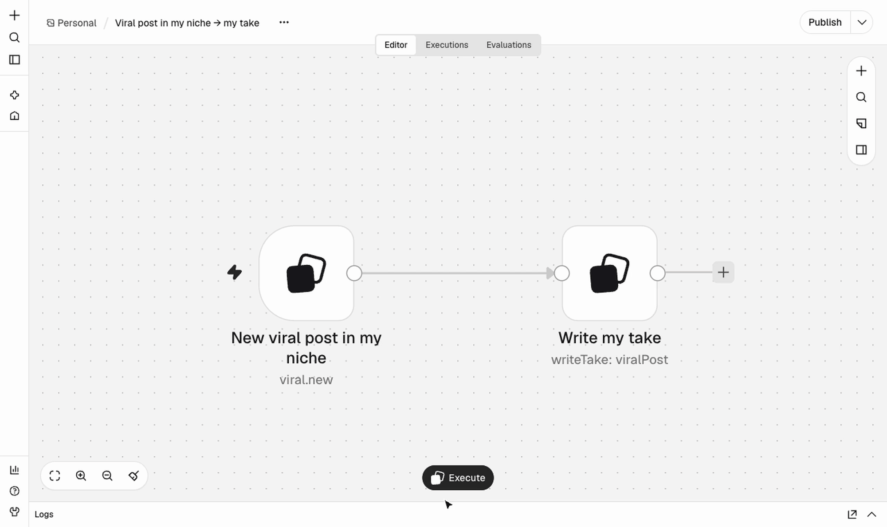
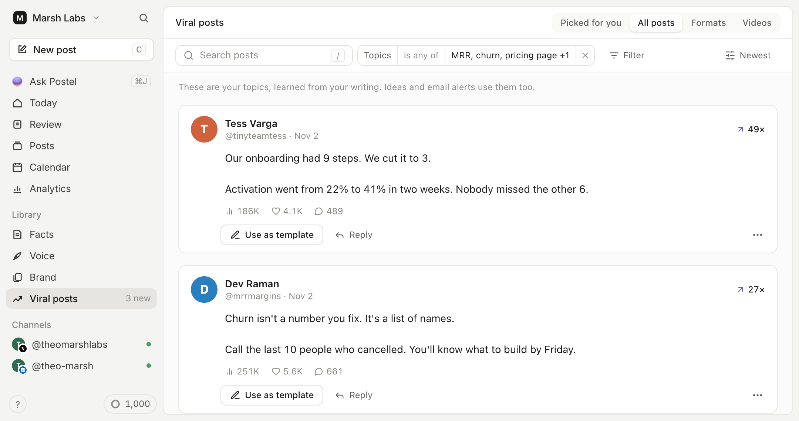
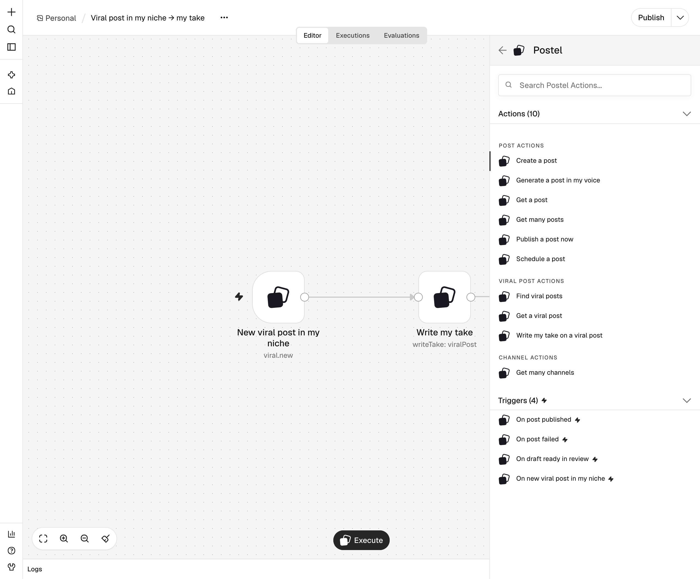

<p align="center">
  <a href="https://www.postel.app">
    <picture>
      <source media="(prefers-color-scheme: dark)" srcset="https://raw.githubusercontent.com/robinfaraj/n8n-nodes-postel/main/assets/postel-logo-dark.png">
      
    </picture>
  </a>
</p>

<h3 align="center">Postel for n8n</h3>

<p align="center">
  Turn what's going viral in your niche into your own posts, automatically. Postel finds it, writes your take in your voice, and schedules it to X, LinkedIn, Bluesky and Mastodon, from any n8n workflow.
</p>

<p align="center">
  <a href="https://www.npmjs.com/package/n8n-nodes-postel"></a>
  <a href="https://docs.n8n.io/integrations/community-nodes/installation/"></a>
  <a href="https://github.com/robinfaraj/n8n-nodes-postel/actions/workflows/publish.yml"></a>
  <a href="https://github.com/robinfaraj/n8n-nodes-postel/blob/main/LICENSE.md"></a>
</p>

<p align="center">
  
</p>

`n8n-nodes-postel` is the n8n community node for [Postel](https://www.postel.app), an AI writing and scheduling tool for X, LinkedIn, Bluesky and Mastodon. It's social media automation for your own content: Postel tracks posts and videos that take off on X, YouTube, TikTok and Instagram, from individual creators rather than brands, and picks out the ones that fit your niche. A workflow can find those posts, have Postel write your own take on one in your voice, and schedule or publish the result through each network's official API.

It also works the other way round: anything that happens in your other apps (a new blog post, an RSS item, a row in your content calendar) can become a post in your voice, and Postel tells your workflow when a post goes out or fails.

[What you can build](#what-you-can-build) · [Install](#install) · [Credentials](#credentials) · [Operations](#operations) · [Triggers](#triggers) · [Good to know](#good-to-know) · [Resources](#resources)

## What you can build

Each of these is a workflow you can import: download the JSON, then in n8n open **Workflows → Import from File** (or paste it onto the canvas) and pick your Postel credential.

| Workflow | What it does |
|---|---|
| [Viral post in my niche → my take → Slack](https://github.com/robinfaraj/n8n-nodes-postel/blob/main/examples/viral-post-to-slack.json) | When a creator's X post takes off in your niche, Postel writes your take on it as a LinkedIn draft and Slack shows you the text. You schedule it in Postel. |
| [Every Monday: viral ideas → drafts](https://github.com/robinfaraj/n8n-nodes-postel/blob/main/examples/weekly-viral-ideas.json) | Finds the week's top 3 viral X posts on your topic and writes your take on each for LinkedIn and X. A week of ideas without scrolling. |
| [New blog post (RSS) → LinkedIn post in my voice](https://github.com/robinfaraj/n8n-nodes-postel/blob/main/examples/rss-to-linkedin-draft.json) | Every new item in your RSS feed becomes a LinkedIn draft written the way you write. |
| [Content calendar (Google Sheets) → scheduled posts](https://github.com/robinfaraj/n8n-nodes-postel/blob/main/examples/content-calendar-to-scheduled-posts.json) | Plan posts in a sheet (date, time, channel, text); each morning today's rows are scheduled in Postel. |
| [Post failed → email me the reason](https://github.com/robinfaraj/n8n-nodes-postel/blob/main/examples/failed-post-alert.json) | If a post can't go out (say, an expired LinkedIn connection), you get an email with the post and why. |

<p align="center">
  
  <br>
  <sub>The viral library in Postel. The node reads the same library.</sub>
</p>

## Install

**n8n Cloud and self-hosted n8n:** open **Settings → Community nodes → Install**, enter `n8n-nodes-postel`, and confirm. The full steps are in n8n's [community nodes installation guide](https://docs.n8n.io/integrations/community-nodes/installation/).

Once installed, search for **Postel** in the nodes panel. There are two nodes: **Postel** (actions) and **Postel Trigger** (starts a workflow).

<p align="center">
  
</p>

## Credentials

1. In [Postel](https://www.postel.app/app), open **Settings → API keys** and create a key. It starts with `pstl_`.
2. In n8n, create a **Postel API** credential and paste the key. n8n checks it right away.

The key acts for the Postel workspace it was made in. Leave **Base URL** as it is.

## Operations

**Postel** node

| Resource | Operation | What it does |
|---|---|---|
| Viral Post | **Find** | Posts and videos that took off on X, YouTube, TikTok or Instagram, from individual creators (no brands, politicians or aggregator pages). Filter by topic, days back, minimum outlier score (X: views ÷ followers; videos: times the creator's usual views), views, format (X) or length (videos). |
| Viral Post | **Get** | One viral post by ID. |
| Viral Post | **Write My Take** | Postel writes your own post from a viral X post (videos aren't supported yet) or a format, in your voice, one draft per network (LinkedIn, X). 1 AI credit per network; takes 10 to 40 seconds. |
| Post | **Create** | Save a post as a draft, schedule it for a time, or publish it now. Optional media links (images or a video) and a LinkedIn first comment. |
| Post | **Generate in My Voice** | Postel writes a post from a topic, notes or a link in your own voice and saves it as a draft. 1 AI credit; takes 5 to 30 seconds. |
| Post | **Schedule** | Schedule a draft that's already in Postel. |
| Post | **Publish Now** | Publish a draft within a minute. The step returns at once (status `scheduled`); the Postel Trigger tells you when it's live or if it failed. |
| Post | **Get** / **Get Many** | Read posts, filtered by status or channel. |
| Channel | **Get Many** | The networks you can post to and which are connected. |

The Postel node can also be used as a tool by n8n's AI Agent node.

## Triggers

**Postel Trigger** node (polling)

| Event | Fires when | Plan |
|---|---|---|
| **New Viral Post in My Niche** | A post or video took off in your niche, as Postel scored it for you. Includes how well it fits. | Pro, with your niche set up in Postel |
| **Post Published** | One of your posts went out. Includes its link. | Any |
| **Post Failed** | A post couldn't be published. Includes the reason; Postel moves the post back to drafts. | Any |
| **Draft Ready in Review** | Postel wrote a new post for you and it's waiting in Review. | Pro |

The first poll only remembers what's already there, so turning a workflow on doesn't fire for old posts.

## Good to know

**Networks.** Postel publishes to X, LinkedIn (personal profiles), Bluesky and Mastodon. Connect them in Postel under **Settings → Channels**.

**Threads.** On X, Bluesky and Mastodon, put a line with only `---` between the parts of a thread:

```
First post of the thread
---
Second post
```

**Plans.** Saving drafts works on every Postel plan. Scheduling and publishing need a paid plan; without one, the node stops with a message that links to the billing page. If your workspace needs approval before posts go out, scheduled posts wait for an owner or admin, and Publish Now asks you to schedule instead.

**Dates.** Times without a timezone use the workflow's timezone.

**Errors.** Postel's errors come through as Postel wrote them (for example "Connect LinkedIn in Postel (Settings → Channels), then run this step again."), with Postel's error code in the details.

**Retries.** Create, Generate in My Voice and Write My Take send an `Idempotency-Key` made of the execution, node and item, so n8n's **Retry On Fail** never posts twice or spends a second credit. Publish Now goes through Postel's publishing queue, so the step is quick and can't time out halfway.

## Compatibility

Built and tested with n8n node API version 1 and `@n8n/node-cli` 0.54. No runtime dependencies.

## Resources

- [Postel](https://www.postel.app): the app, plans and pricing
- [Postel API reference](https://www.postel.app/api/docs): the public REST API this node uses (section **Public API v1**), if you'd rather use the HTTP Request node
- [Postel for Zapier, n8n and Make](https://www.postel.app/automations)
- [n8n community nodes documentation](https://docs.n8n.io/integrations/#community-nodes)
- Help: [Postel's Discord](https://discord.gg/vXUvyuPfBH) or [open an issue](https://github.com/robinfaraj/n8n-nodes-postel/issues)

## Development

```bash
npm install
npm run lint
npm run build
npm test                         # offline checks
POSTEL_TEST_URL=http://localhost:3000 POSTEL_TEST_KEY=pstl_... npm test   # also runs against a Postel API
npm run dev                      # n8n with this node loaded, at http://localhost:5678
```

Live tests create drafts and scheduled posts in the key's workspace, so use a test workspace.

## License

[MIT](https://github.com/robinfaraj/n8n-nodes-postel/blob/main/LICENSE.md)
